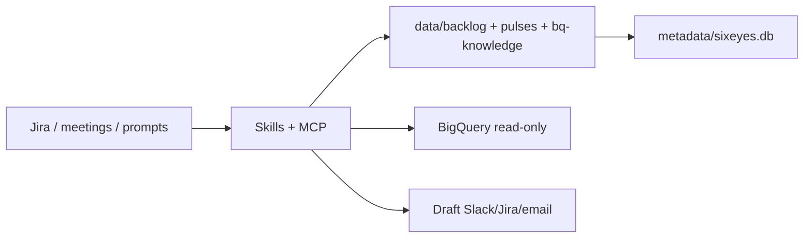

# Six Eyes architecture (template)

## What Six Eyes is

A **local-first** analytics operating system: skills watch engineering signals (Jira, meetings, warehouse context), maintain a scored backlog in Git, and produce weekly pulse artifacts. Humans approve every promote and every outbound message.

## Principles

1. **Local-first** — Markdown + YAML in `data/` is authoritative; SQLite index is derived (`scripts/init-db.py`).
2. **Composable skills** — Each skill is a small workflow; `/six-eyes-run` chains them with staging.
3. **Human-in-the-loop** — Staging gate + outbound PreToolUse guard.
4. **Compressed handoff** — State in `data/state/` and backlog frontmatter.

## Layers

## Data conventions

- Backlog: `data/backlog/{ID}-{slug}.md` with YAML frontmatter (see manifest schema notes).
- Pulse: `data/pulse-checks/YYYY-Www-pulse.md`
- Deep dive: `data/deep-dives/YYYY-Www-{slug}.md`
- Staging: `data/staging/staged/` until `scripts/six-eyes-promote.py`

## Context layer

Human-authored `data/bq-knowledge.md` exports to `config/context/*.yaml` via `scripts/export_context.py`. Schema `meta.business_rules` paraphrases are checked by `scripts/check_schema_meta.py`.

## Runtime modes

| Mode | Jira / meetings | BigQuery |
|------|-----------------|----------|
| offline | `sample-inputs/` fixtures | Optional; dry-run recommended |
| live | MCP Atlassian / Granola | GCP credentials + `bq_client.py` |

## Governed repo (optional)

Promotion plans: `scripts/governed_knowledge_promote.py` → `outputs/governed-promotion/`. See `docs/governed-knowledge-promotion.md`. No shipped stub repo in the template.

## Web UI

`webapp/backlog_board/` — Flask HTMX kanban over backlog markdown.

## Roadmap (template)

- Regenerate `docs/six-eyes-explorer.html` via `scripts/build-explorer.py` (Stage 3)
- Full GHA draft-PR promotion to `GOVERNED_REPO`
